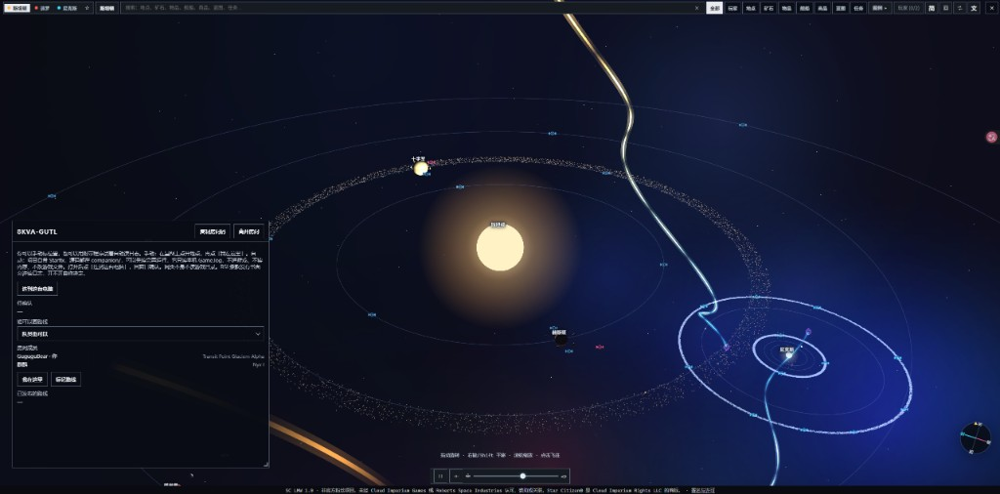
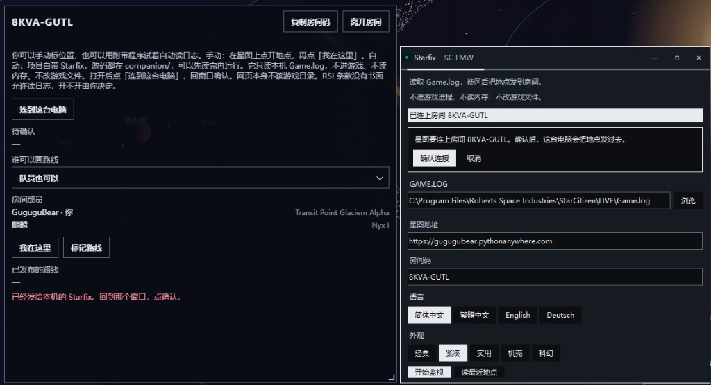
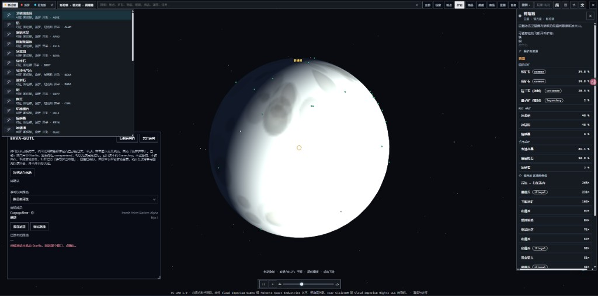
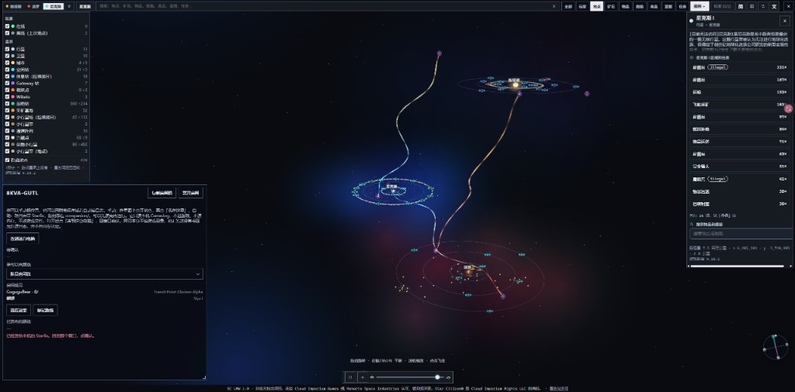
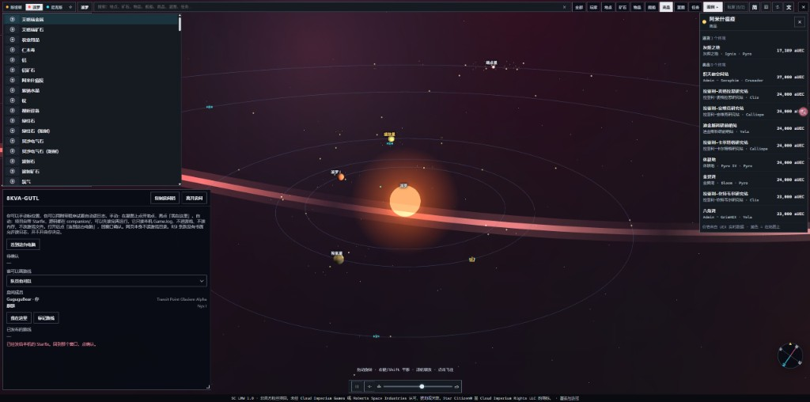

# SC LMW – 星際公民星圖

**版本 1.1.0** · AGPL-3.0 · Starfix 1.0.9

[English](README.md) · [Deutsch](README.de.md) · [简体中文](README.zh-Hans.md) · **繁體中文**

一套免費、開源的星際公民三維星圖：斯坦頓、派羅、尼克斯。可以搜尋，看即時物價和艦船模型，開團隊房間。另有一個可選的日誌讀取程式，只在你自己的電腦上執行。

> **非官方粉絲專案。** 未獲 Cloud Imperium Games 或 Roberts Space Industries 認可、贊助或關聯。Star Citizen®、Squadron 42®、Roberts Space Industries®、Cloud Imperium® 是 Cloud Imperium Rights LLC 與 Cloud Imperium Rights Ltd. 的註冊商標。首頁和頁尾都有這段說明。嵌到別的網站時，請讓它保持可見。

## 這一份網站的網址

| | 網址 | 是什麼 |
|---|---|---|
| 對外名稱 | https://sclmw.cltbbs.com/ | 給訪客用的網址。瀏覽器網址列保持這個名字。 |
| 來源站 | https://gugugubear.pythonanywhere.com/ | PythonAnywhere 上的應用。同一套頁面，也可以直接打開。部署也發到這裡。 |

`sclmw.cltbbs.com` 是反向代理，不是重新導向，也不是把 CNAME 指到來源站。Cloudflare 區域 `cltbbs.com`，Worker 名 `sclmw-proxy`，自訂主機名 `sclmw.cltbbs.com`。Worker 去取 `https://gugugubear.pythonanywhere.com`，請求標頭 `Host` 用來來源站的主機名；如果上游的 `Location` 會露出來源站，就改回目前主機名。Worker 指令碼不在這個儲存庫裡。要換來源站，改 Worker 裡的 `ORIGIN` 常數，再把指令碼上傳一次。

兩個網址是同一套應用。房間請求和地圖檔案都用相對路徑，所以從哪個名字打開，就留在哪個名字上。Starfix 1.0.9 接受從這兩個名字發起的連線。見 [companion/README.md](companion/README.md)。

Cloudflare 可能把靜態檔案留幾個小時。2026 年 10 月 30 日查過：對外名稱上的 `js/starmap.js` 是 `cache-control: max-age=14400`、`cf-cache-status: HIT`，來源站當時已經是更新的檔案。部署完成後，來源站在 Action 成功時就換好了。對外名稱要等這份快取過期。房間介面來自 [server/room_server.py](server/room_server.py)，回應帶 `Cache-Control: no-store`。頁面本身不是私人文件。登入狀態是 `localStorage` 裡的 Bearer 權杖，不是 Cookie。

## 改之前要知道的

- 網站不讀遊戲資料夾。只有你在自己電腦上啟動的 Starfix，才會打開你選定的那一個日誌檔。
- `data/` 在一台機器上產生，不進 git。推送不會上傳它，也不會換掉伺服器上已經放著的那一份。產生步驟寫在下面。
- 不要提交 `companion/config.json`、`server/*.sqlite`、`data/loc.json`、`.env`，也不要提交 PythonAnywhere 權杖。部署用的密鑰是 GitHub Actions 祕密 `PA_API_TOKEN`。
- 第四個星系不會自己出現。[scripts/systems-build.py](scripts/systems-build.py) 裡寫的是斯坦頓、派羅、尼克斯。頁面上的按鈕跟這份名單一致。
- 中文地名來自我方電腦的遊戲 Language 資料夾，用 `python scripts/loc-build.py` 產生。這一步不在 `scripts/build-all.py` 裡。產生的 `data/loc.json` 不進 git。
- 地圖上的商店和設施，有官方文字就用官方文字。沒有正式店名的，保持英文。
- 介面文字至少 12px。Starfix 自己的視窗保持 9pt。見 [css/starmap.css](css/starmap.css) 和 [companion/desk.py](companion/desk.py)。

## 使用星圖

打開對外名稱或來源站。首頁是團隊房間：建房間、用房間碼加入，或進入公開房間。一個瀏覽器同時只在一個房間裡。隊長可以改公開或私人、通過申請、移出成員、發廣播。公開房間列在首頁。

星圖上，搜尋在頂列。縮放條在同一條頂列裡，緊鄰搜尋框右邊，高度跟頂列一致。分類按鈕在旁邊。在地點上右鍵，可以選「我在這裡」；房間允許時，也可以從這裡畫路線。

**模糊其他星系** 預設開著。靠近看某一個星系時，另外的星系變模糊，也不能點。拉遠到三個星系一起入畫時，它們重新變清晰。開關在操作設定的「其他」：文案鍵是 [js/i18n.js](js/i18n.js) 裡的 `ctrl.blurBg`，和別的操作開關一起存在 `localStorage` 的 `sclmw_controls`。

點隊員列表或玩家列表裡的名字，會打開這個人的卡片和虛線。卡片有日誌裡的欄位；這個地點在地圖上時，還會有距恆星的距離、設施和終端。隊員列表顯示每個人的伺服器，方便隊長看是不是同一台。

主題：經典、緊湊、實用、機殼、科幻、氣霧。預設是氣霧。訪客自己的選擇留在瀏覽器裡。氣霧是青色儀表板那種樣子（`data-theme="haze"`）。

1.1.0 的介面說明在 [docs/WHATS_NEW.md](docs/WHATS_NEW.md)。那不是之後每一次改動的清單。寫那些說明時旁邊的 Starfix 版本已經不是現在的版本。以 `companion/VERSION` 為準。

## Starfix

可選。沒有它也能用星圖：右鍵選「我在這裡」。

Starfix 讀取這台電腦上的 `Game.log`。你確認之後，它把地點代碼發到房間。它不進遊戲行程，不讀記憶體，不上傳整份日誌。執行原始碼之前先讀 [companion/README.md](companion/README.md)。

已發布的安裝包：[Starfix 1.0.9](https://github.com/GuguguBear/sc-lmw/releases/tag/starfix-1.0.9)。程式拿 `companion/VERSION` 和名為 `starfix-X.Y.Z` 的 GitHub Release 比較。把 `companion/**` 或 [.github/workflows/starfix-release.yml](.github/workflows/starfix-release.yml) 推到 `master`，如果這個標籤還不存在，就會打出 exe。[companion/write_version_info.py](companion/write_version_info.py) 用同一個版本號寫 Windows 的版本資訊。

更新時，視窗用你已經選好的主題，顯示箱子裝進貨櫃的進度。下載結束後，輔助程式把新檔案蓋到你剛才打開的那個檔案上。Windows PowerShell 的 `Move-Item -Force` 換不掉已經存在的 exe，所以輔助程式用 `System.IO.File.Copy`。如果你打開的檔案名叫 `Starfix 1.0.6.exe`，新檔案會是 `Starfix 1.0.8.exe`，舊名字會去掉。檔名就是 `Starfix.exe` 的，繼續用這個名字。

更早的版本可能已經下載了 `Starfix.update.exe`，舊程式卻還在。先關掉 Starfix，再雙擊旁邊的 `Starfix.update.exe`。這個檔案會把自己換上去並打開新程式。從 1.0.8 起，進度窗和覆蓋都從你確認的那次更新裡執行。

Starfix 允許這些頁面來源，另外還有 `http://127.0.0.1` 和 `http://localhost`：

- `https://gugugubear.pythonanywhere.com`
- `https://sclmw.cltbbs.com`

新打開的視窗裡，星圖位址是 `https://sclmw.cltbbs.com`。如果保存的位址還是以前內建的 `https://gugugubear.pythonanywhere.com`，這個版本下次啟動時會換成新位址。從某個頁面連過來時，存的是那個頁面自己的位址。

從某個頁面點「連到這台電腦」，就會把那個頁面的來源存成介面位址。更早安裝的程式會一直用 PythonAnywhere，直到你再連一次。代理在前面時，兩個網址都可以用。

## 部署這一份網站

推送到 `master` 會啟動 [.github/workflows/deploy.yml](.github/workflows/deploy.yml)。工作取出儲存庫，再執行 [scripts/deploy_pythonanywhere.py](scripts/deploy_pythonanywhere.py)。

這個指令碼會：

1. 從環境變數讀 `PA_API_TOKEN`。在 GitHub 上，這是同名的 Actions 祕密。權杖在 PythonAnywhere 帳戶頁建立。
2. 用 `git ls-files` 列出檔案。未追蹤和被 git 忽略的檔案不會上傳。
3. 把這些檔案上傳到 `www.pythonanywhere.com` 上使用者 `GuguguBear` 的 `/home/GuguguBear/sc-lmw`。
4. 重新載入 Web 應用 `gugugubear.pythonanywhere.com`。

它不會刪除伺服器上多出來的檔案，也不會換掉已經在伺服器上的 `data/` 或房間資料庫。資料重新產生之後，要自己把新的 JSON 拷到伺服器。

對外名稱不是這個指令碼登記的。DNS 和 Worker 在 Cloudflare。發布一次網頁改動就是：提交，推送 `master`，等到名為 “Update the live site” 的 Action 成功，並記住對外名稱可能還會把快取裡的 JS 和 CSS 再留幾個小時。

GitHub 上平時走 Pull Request。管理員直接推 `master` 可以繞過這條規則。這種推送出現繞過提示是預期情況。

## 自己跑一份

需要 Python 3。網站本身不用 Node 建置。

```sh
git clone https://github.com/GuguguBear/sc-lmw.git
cd sc-lmw
python scripts/build-all.py
python -m http.server 8000
```

打開 http://localhost:8000/ 。在你接到房間或玩家列表之前，地圖上是示例飛行員。社群的遊戲資料匯出更新之後，再跑一次 `build-all.py`。

| 參數 | 作用 |
|---|---|
| `--with-de` | 德語遊戲文字。見 [scripts/README_DE_INI.md](scripts/README_DE_INI.md)。 |
| `--with-loot` | Friendly Fire Department 匯出的掉落地點。不放進 git。 |

物價和艦船模型是瀏覽器裡向 UEX 和 FleetYards 現取的，不在這次建置的檔案裡。

## 嵌到別的網站

**iframe**

```html
<iframe src="https://sclmw.cltbbs.com/"
        style="width:100%;height:640px;border:0" allow="fullscreen"></iframe>
```

**一個 script 標籤。** 星圖留在這個元素裡，不會去改你的 `body`。

```html
<div id="sc-lmw" style="height:640px"></div>
<script src="https://your-site.example/sc-lmw/js/sc-lmw.js"
        data-base="https://your-site.example/sc-lmw/"
        data-players-url="https://your-site.example/api/players"></script>
```

例子：[examples/iframe.html](examples/iframe.html)、[examples/embed.html](examples/embed.html)。給助手用的說明在 [docs/AI_INTEGRATION.md](docs/AI_INTEGRATION.md)。飛行員 JSON 的約定在 [docs/PLAYERS_API.md](docs/PLAYERS_API.md)。這一份網站的團隊房間是 [server/room_server.py](server/room_server.py) 裡的服務。[config.js](config.js) 裡的 `PLAYERS_URL` 是另一條路：你自己的飛行員列表。

語言：`config.js` 裡的 `LANG`（`auto`、`de`、`en`、`zh-Hans`、`zh-Hant`），或 script 上的 `data-lang`，或 `SCLMW.mount(el, { lang: 'zh-Hant' })`。第一次打開跟隨瀏覽器。按鈕可以當場切換，選擇會留下。

主題：`config.js` 裡的 `THEME`（`compact`、`classic`、`practical`、`chassis`、`scifi`、`haze`），或 `data-theme`，或 `mount(el, { theme })`。訪客自己的選擇優先。

## 資料從哪來

| 內容 | 來源 | 方式 |
|---|---|---|
| 地點、礦石、物品、藍圖、任務 | 社群的 `scunpacked-data` 匯出 | `scripts/build-all.py`。不提交。 |
| 中文名 | 本機遊戲 Language 檔案 | `scripts/loc-build.py`。不提交。 |
| 物價 | [UEX](https://uexcorp.space) | 瀏覽器裡現取。 |
| 艦船參數和模型 | [FleetYards](https://fleetyards.net) | 瀏覽器裡現取。應用裡有署名。 |
| 三維引擎 | [three.js](https://threejs.org) r128（MIT） | `vendor/three/` |
| 本站的團隊 | 房間服務 | [server/room_server.py](server/room_server.py) |
| 你自己的飛行員 | `PLAYERS_URL` | 可選。[docs/PLAYERS_API.md](docs/PLAYERS_API.md) |

遊戲檔案不在這裡散布。署名見 [CREDITS.md](CREDITS.md)。

指南和計時：[starcitizen.tools](https://starcitizen.tools)，[exec.xyxyll.com](https://exec.xyxyll.com) 經 `scripts/exec-build.py`，[exectimer.com](https://exectimer.com)。掉落地點只有加上 `--with-loot` 才有。

## 目錄

```
index.html                 本站頁面
config.js                  PLAYERS_URL、語言、主題、輪詢間隔
manifest.webmanifest       可安裝的應用
sw.js                      離線外殼；/api/ 仍走網路
js/starmap.js              星圖、搜尋、模糊、飛行員卡片
js/room.js                 首頁、房間、隊員、廣播
js/i18n.js                 de / en / zh-Hans / zh-Hant
js/history.js              本機的個人日誌回放
css/starmap.css            .sc-lmw 下的樣式
server/room_server.py      本站使用的房間介面
companion/                 Starfix。見 companion/README.md
scripts/deploy_pythonanywhere.py
.github/workflows/deploy.yml
.github/workflows/starfix-release.yml
docs/PLAYERS_API.md
docs/AI_INTEGRATION.md
docs/WHATS_NEW.md          網站 1.1.0 的說明
```

## 畫面

| 重新整理之後房間還在 | 斯坦頓星圖上的團隊房間 |
|---|---|
|  |  |

| 連到這台電腦上的 Starfix | 靠近一顆行星 |
|---|---|
|  |  |

| 斯坦頓裡打開的一個地點 | 派羅 |
|---|---|
|  |  |

## 授權

**AGPL-3.0。** 見 [LICENSE](LICENSE)。如果你把修改過的版本當成網路服務給別人用，就要把這份修改過的原始碼提供給他們。第三方程式碼和資料仍用它們自己的授權。見 [CREDITS.md](CREDITS.md)。
